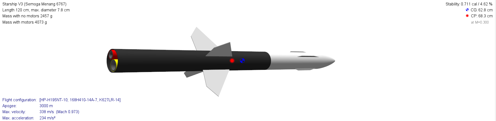
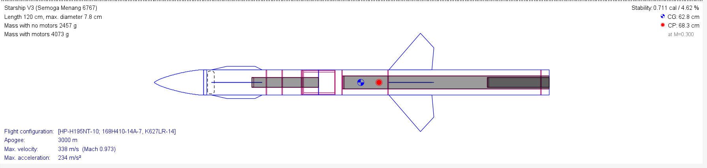

# Starship V3: Two-Stage Retropropulsive Landing Study

A two-stage, parachute-free rocket designed and simulated in OpenRocket for **BIRST 2026** (Brazilian International Rocket Simulation Tournament), Level 3, "Falcon Rocket" challenge.

The rocket replays the Falcon 9 Crew-9 launch from Cape Canaveral using a real wind profile, climbs to a 3,000 m apogee, separates its stages, and tries to land both using timed engine burns only: no parachutes, no active guidance.

**Authors:** khomeng.khomey (Khomey) and [Renee](https://akirenaki.github.io/)\
**Competition result:** Silver Tier, ranked 16th at the international level (Level III, Falcon rocket) with a score of −3,150,147.609, as team Semoga Menang 6767. See the details at the [OSIFOG/BIRST official website](https://osifog.com.br/premiados-2026.html)



## Results at a glance

| | Result | Target / rule |
|---|---|---|
| Apogee | **2,999.97 m** | 3,000 m |
| Peak Mach number | **0.973** | must stay subsonic |
| Liftoff mass | 4.07 kg | n/a |
| Launch-rod exit speed | 36.9 m/s | n/a |
| Touchdown speed, upper stage | 16.7 m/s | below 5 m/s |
| Touchdown speed, booster | 14.9 m/s | below 5 m/s |
| Landing distance from pad | 0.86 km (upper), 0.95 km (booster) | 0 km |
| Propellant consumed | about 0.88 kg | less is better |

The ascent was accurate. The descent is where the design falls short: both landing burns removed most of the downward speed, but both stages still touched down well above the 5 m/s goal and drifted downwind. More on that under [Limitations](#limitations-and-what-wed-change).


## The competition

BIRST is the international version of OSIFOG, a Brazilian olympiad for rocket simulation. The exam is entirely practical: teams of one to three people design a rocket in OpenRocket from a single mission brief over one week. International teams enter Level 3 only.

**Level 3 mission:** replicate the return and propulsive landing of SpaceX's Falcon programme in simulation.

Key rules:

1. Land all stages below 5 m/s with no passive recovery devices.
2. Return with engine braking only, with no active stability control after separation.
3. Use multiple stages.
4. Reproduce the real launch-site atmosphere with OpenWind.
5. Record each stage's trajectory in Google Earth with OpenEarth.

Mandatory replay conditions:

| Item | Value |
|---|---|
| Launch site | Space Launch Complex 40, Cape Canaveral, Florida |
| Replay event | Falcon 9 Crew-9 (first stage B1085) |
| Date and time | 28 September 2024, 17:17:21 UTC |
| Target apogee | 3,000 m |

Scoring starts at 900,000 and subtracts penalties for apogee error, horizontal position at apogee, mean landing position, mean landing speed, and propellant used. Negative scores are normal, and only the ranking against other teams matters.

Other hard constraints: stock OpenRocket motors only, materials between 0.17 and 11.34 g/cm³, subsonic flight throughout, maximum rocket height 4 m, no manual overrides of mass, drag or CG, and exactly one stored simulation.

## Design



Two stages share a 78 mm body diameter, for a total length of about 1.2 m.

**Upper stage ("Starship")**
- Haack-profile brass nose cone (150 mm) and a 350 mm balsa body tube
- 0.947 kg ballast mass
- AeroTech HP-H195NT landing motor
- Four small brass freeform fins

**Booster**
- 700 mm body tube, 78 mm diameter
- Four swept freeform fins, used as an analogue of Falcon 9's grid fins
- Loki Research K627LR ascent motor
- Cesaroni 168H410-14A landing motor, mounted on the opposite side of the axis

### Propulsion and timing

| Motor | Role | Ignition | Burn |
|---|---|---|---|
| Loki K627LR (booster) | Ascent | Launch | 2.56 s, about 1,526 N·s |
| AeroTech HP-H195NT (upper stage) | Landing | 51.5 s after launch | about 1.14 s |
| Cesaroni 168H410-14A (booster) | Landing | 65.0 s after launch | about 0.40 s |

Landing motors use fixed ignition delays measured from launch. There is no sensing and no feedback, which fits the rule against active control.

### Flight sequence

| Time | Event |
|---|---|
| 0 s | Liftoff |
| 2.1 s | Peak Mach 0.973 at about 421 m |
| 2.56 s | Ascent motor burnout |
| 22.6 s | Apogee (2,999.97 m) and stage separation |
| 51.5 s | Upper stage landing burn |
| 65.0 s | Booster landing burn |

After separation both stages have negative static margin and tumble. The competition's supplied anti-tumble script is the only simulation extension used.

## Launch conditions

| Parameter | Value |
|---|---|
| Location | 28.5619° N, 80.5774° W, 4.86 m above sea level |
| Atmosphere | Extended ISA, 303.25 K base temperature, 100,000 Pa base pressure |
| Wind | 30-layer profile from OpenWind, from about 3 m/s near the ground to a maximum of 14.4 m/s near 1,700 m |
| Wind direction | Roughly from the south-west, carrying the rocket north-east |
| Launch rod | 3.0 m, tilted 6.2° |
| Simulator | RK4, Barrowman aerodynamics, 0.02 s time step |

<!--

-->

## Limitations and what we'd change

- **Landing speed.** Both stages touched down at roughly 15-17 m/s against a 5 m/s goal. Both burns over-corrected the vertical velocity, so each stage briefly rose again before falling back.
- **Wind drift.** Winds of 3-14 m/s carried both stages roughly 0.9 km from the pad. This dominates the score and would need either pre-compensated launch angle or a design that spends less time falling.
- **No feedback.** Fixed-delay ignition means a small error in descent timing becomes a large error in touchdown speed.

Next time we would spend more effort tuning ignition timing and motor choice for the landing burns, and test launch-angle compensation for the wind.

## Repository contents

```
.
├── rocket.ork            OpenRocket design and stored simulation
├── images/               renders, plots, and OpenEarth screenshot
├── BIRST_2026_Rocket_Portfolio.md   extended write-up
└── README.md
```

## Opening the design

1. Install [OpenRocket](https://openrocket.info) 24.12 or newer (free).
2. Open `rocket.ork`.
3. The stored simulation can be viewed on the Simulations tab without re-running it.

## Tools

OpenRocket 24.12 (design and flight simulation) · OpenWind (atmosphere and wind profile) · OpenEarth / Google Earth (trajectory visualisation)

## Credits & Contact Information

Designed by Khomey and Renee. Competition rules and scoring are from the BIRST 2026 regulations and the Level 3 mission documents.


- Khomey's LinkedIn: https://www.linkedin.com/in/husein-khomeini-diansya-walandri-b20369352/
- Renee's Portfolio: https://akirenaki.github.io/
- Renee's GitHub: https://github.com/Akirenaki
- Renee's LinkedIn: https://www.linkedin.com/in/renee-astraea/
